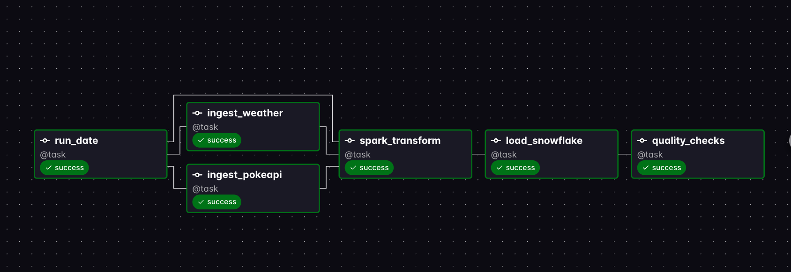
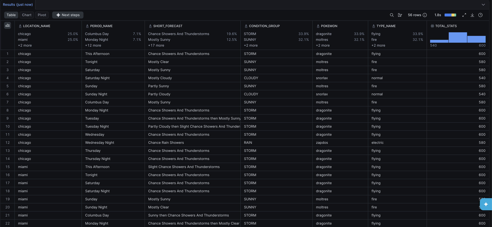
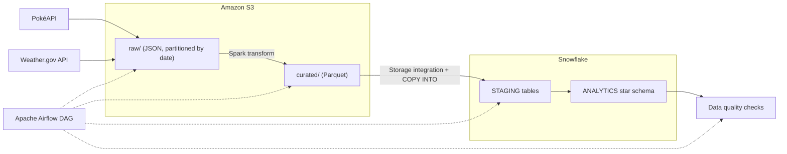
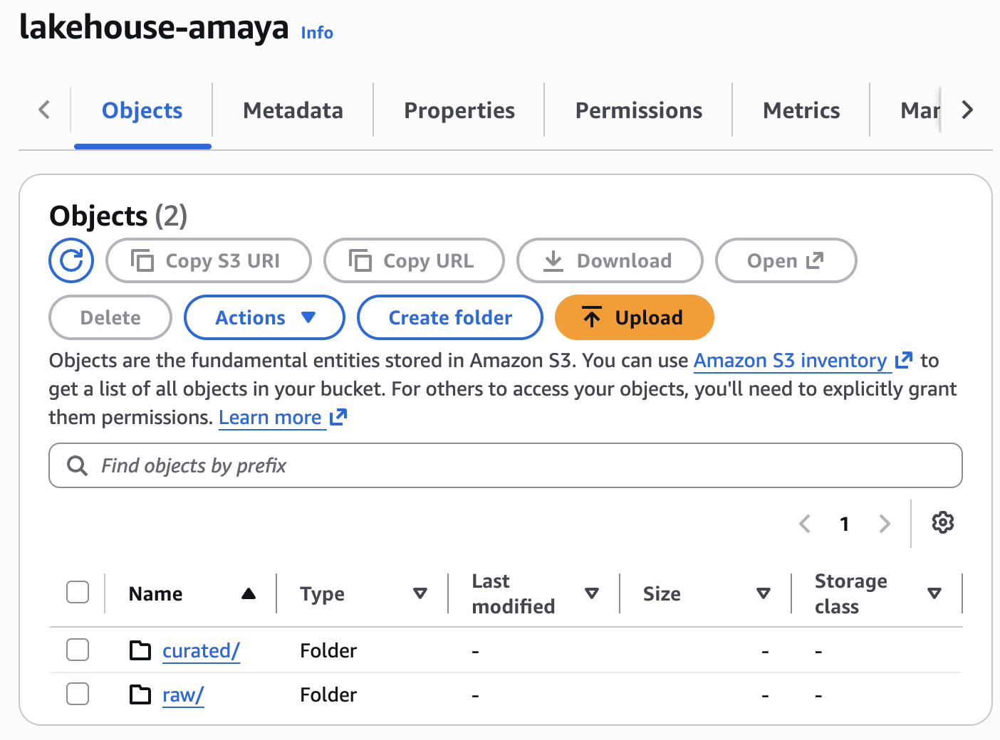
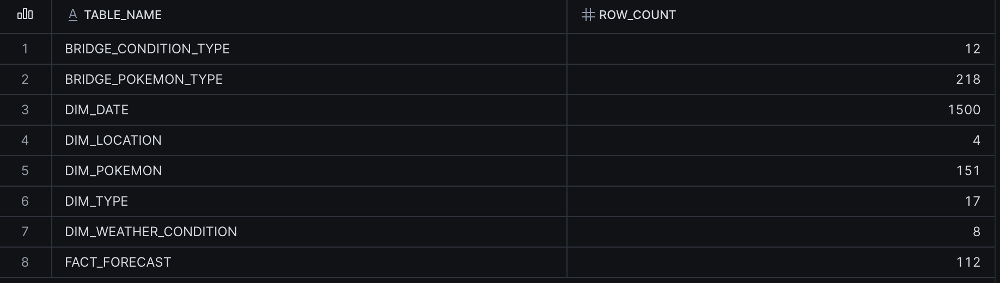
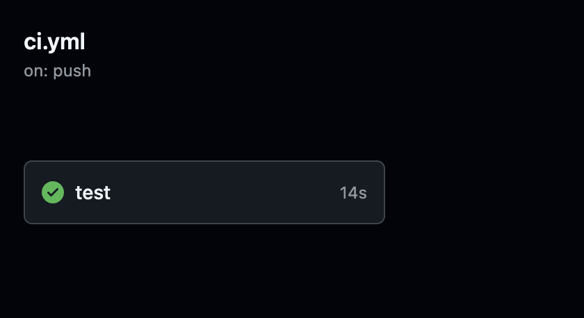

# Modern Lakehouse (Batch): PokéAPI + Weather.gov

An end-to-end batch data pipeline built as my first data engineering portfolio project. It ingests two public APIs into an S3 data lake, transforms the data with Spark, loads it into a Snowflake star schema, validates it with automated data quality checks, and orchestrates the whole thing with Apache Airflow.



## The question the warehouse answers

PokéAPI (static reference data) and Weather.gov (a forecast that changes daily) have no natural relationship, so I created one on purpose. Pokémon have **types** and forecasts have **conditions**, so I built a small mapping table (for example, *rain* maps to *water* and *electric*; *snow* maps to *ice*). That lets the warehouse answer:

> **For each city and forecast period, which Pokémon types match the weather, and which matching Pokémon has the highest total base stats?**

The data is playful. The engineering is the point: two different loading patterns (static reference data vs. time-varying data) and a many-to-many relationship modeled with bridge tables.



## Architecture



**Pipeline stages** (one Airflow DAG, `lakehouse_pipeline`, scheduled daily):

1. `run_date`: fixes one UTC run date and passes it to every downstream task, so all stages agree on the partition even if a run crosses midnight UTC.
2. `ingest_pokeapi` and `ingest_weather`: call the APIs (with retries) and land the **raw, untouched JSON** in `s3://<bucket>/raw/<source>/dt=<date>/`.
3. `spark_transform`: PySpark flattens the nested JSON, enforces types, and writes Parquet to `curated/`.
4. `load_snowflake`: truncates and reloads the staging tables from S3 (via a Snowflake storage integration and `COPY INTO`), then rebuilds the star schema.
5. `quality_checks`: seven automated checks run against the warehouse. Any failure fails the DAG run.



## Tech stack

| Layer | Tools |
|---|---|
| Sources | PokéAPI, Weather.gov API |
| Data lake | Amazon S3 (raw and curated zones), IAM least-privilege access |
| Processing | Apache Spark (PySpark 3.5) |
| Warehouse | Snowflake (staging schema plus star schema) |
| Orchestration | Apache Airflow 3 (Astro CLI, runs in Docker) |
| Quality and CI | Custom SQL checks, pytest, ruff, GitHub Actions |
| Language and packaging | Python 3.11, Docker |

## Star schema

| Table | Type | Purpose |
|---|---|---|
| `FACT_FORECAST` | Fact | One row per city per forecast period (temperature, wind, short forecast) |
| `DIM_LOCATION` | Dimension | Cities and coordinates |
| `DIM_DATE` | Dimension | Calendar attributes |
| `DIM_WEATHER_CONDITION` | Dimension | Weather groups (sunny, rain, storm, snow, and so on) |
| `DIM_POKEMON` | Dimension | Pokémon and base stats |
| `DIM_TYPE` | Dimension | Pokémon types |
| `BRIDGE_POKEMON_TYPE` | Bridge | Pokémon to type (many-to-many) |
| `BRIDGE_CONDITION_TYPE` | Bridge | Weather condition to type mapping |



## Data quality and CI

After every load, `src/quality/checks.py` verifies: expected Pokémon count, unique Pokémon IDs, forecast rows exist, no null location keys, every forecast has a condition, temperatures are in a plausible range, and every Pokémon has at least one type.

GitHub Actions runs `ruff` (lint) and `pytest` on every push.



## Run it locally (no cloud accounts needed)

Local mode runs ingestion and the Spark transform and writes Parquet files to `./data/`. It stops before the warehouse step, since that needs Snowflake.

```bash
git clone https://github.com/AmayaTibana/modern-lakehouse.git
cd modern-lakehouse

# Optional but polite: weather.gov asks API users to identify themselves
export WEATHER_USER_AGENT="modern-lakehouse-demo-you@example.com"

docker compose -f docker-compose.local.yml up --build
ls data/curated/pokeapi/pokemon data/curated/weather/forecasts
```

Requires Docker Desktop. Tested on macOS.

## Run it in the cloud (AWS and Snowflake)

You need an AWS account and a Snowflake account (a free trial works).

1. Copy `.env.example` to `.env` and fill in your values. **Never commit `.env`.**
2. **AWS:** create an S3 bucket and an IAM user limited to that bucket. Create a second IAM role that Snowflake can assume with read-only access to `curated/`.
3. **Snowflake:** run `src/sql/01_setup.sql` and `src/sql/02_staging_tables.sql` once. The role trust-policy update in AWS is a manual step described in the comments of `01_setup.sql`.
4. **Authentication:** Snowflake is retiring single-factor password sign-ins, so the loader uses **key-pair authentication**. Generate a key pair, register the public key on your Snowflake user, and set `SNOWFLAKE_PRIVATE_KEY_PATH` in `.env`.
5. **Run the pipeline** either step by step:

   ```bash
   python -m src.ingest.ingest_pokeapi
   python -m src.ingest.ingest_weather
   python -m src.spark_jobs.transform
   python -m src.load.load_snowflake
   python -m src.quality.checks
   ```

   or with Airflow:

   ```bash
   astro dev start
   ```

   Then trigger `lakehouse_pipeline` in the Airflow UI.

## Design decisions and trade-offs

- **Raw JSON is stored untouched.** Any bug in a later stage can be fixed by reprocessing from the raw zone.
- **Spark runs in local mode, not on an EMR cluster.** The data is small, and a managed cluster would cost money without teaching more. The code is the same Spark code that would run on a cluster, and a cluster would be the first scale-up step.
- **Truncate-and-reload for staging, full rebuild for the star schema.** Simple and idempotent at this size. At scale I would use incremental `MERGE` loads.
- **Weather history accumulates.** Each daily run writes a new `ingest_date` partition to the curated zone, and the fact table is rebuilt from all of them (112 rows after two daily runs). The example query filters to the latest snapshot.
- **One run date shared by every task.** An early design let each task compute "today" separately, which risks a mismatch around midnight UTC.
- **Key-pair authentication** instead of passwords, because of Snowflake's authentication changes.
- **Two modes (local and cloud) from the same code**, switched by one setting (`STORAGE_MODE`), so reviewers can run the project without accounts.

## Known limitations

- The weather-to-type mapping is deliberately arbitrary. It exists to create a join, not because it is meaningful.
- Nighttime forecasts such as "Mostly Clear" are classified as `SUNNY` because the rule matches the word "clear". Using the `is_daytime` column would fix this.
- Pokémon data is static but is re-ingested daily.
- Only 4 cities and the first 151 Pokémon.
- The warehouse step uses the `ACCOUNTADMIN` role for simplicity. A real deployment would use a least-privilege role.
- Local mode does not include the warehouse step.

## What I would do next

- Store the curated layer in Delta Lake or Iceberg to make it a true lakehouse table format.
- Move the transformations to dbt with built-in tests.
- Incremental loads with `MERGE`.
- A local DuckDB warehouse so local mode can reproduce the final query.
- Infrastructure as code (Terraform) for the AWS and Snowflake resources.

## Cost

Built entirely on the AWS Free plan and a Snowflake trial. Warehouse auto-suspend is set to 60 seconds and Spark runs locally to avoid cluster costs.

## Project structure

```
modern-lakehouse/
├── dags/lakehouse_pipeline.py      # Airflow DAG
├── src/
│   ├── ingest/                     # API ingestion + S3/local writer
│   ├── spark_jobs/transform.py     # PySpark transformations
│   ├── load/load_snowflake.py      # Snowflake loader (key-pair auth)
│   ├── quality/checks.py           # Data quality checks
│   └── sql/                        # Snowflake setup, staging, star schema, example query
├── tests/                          # pytest tests
├── docs/screenshots/               # Images used in this README
├── .github/workflows/ci.yml        # GitHub Actions CI
├── Dockerfile.local                # Local-mode image
├── docker-compose.local.yml        # Local-mode run
├── docker-compose.override.yml     # Airflow (Astro) volume mounts
├── requirements.txt                # Airflow container dependencies
├── requirements-dev.txt            # Local development dependencies
└── .env.example                    # Required environment variables (no secrets)
```

## Author

Carlos Amaya Tibana ([GitHub](https://github.com/AmayaTibana) · [LinkedIn](https://www.linkedin.com/in/carlos-amaya-tibana-9637b1306))
